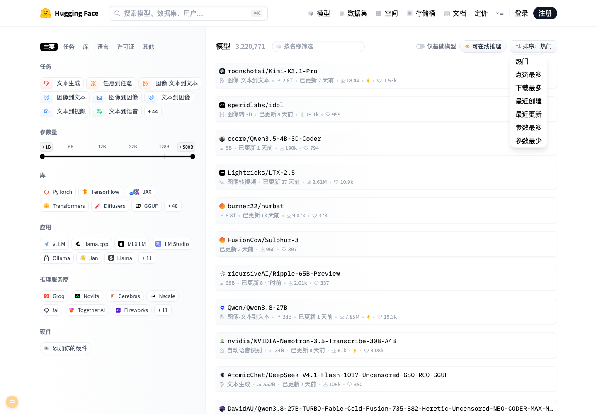
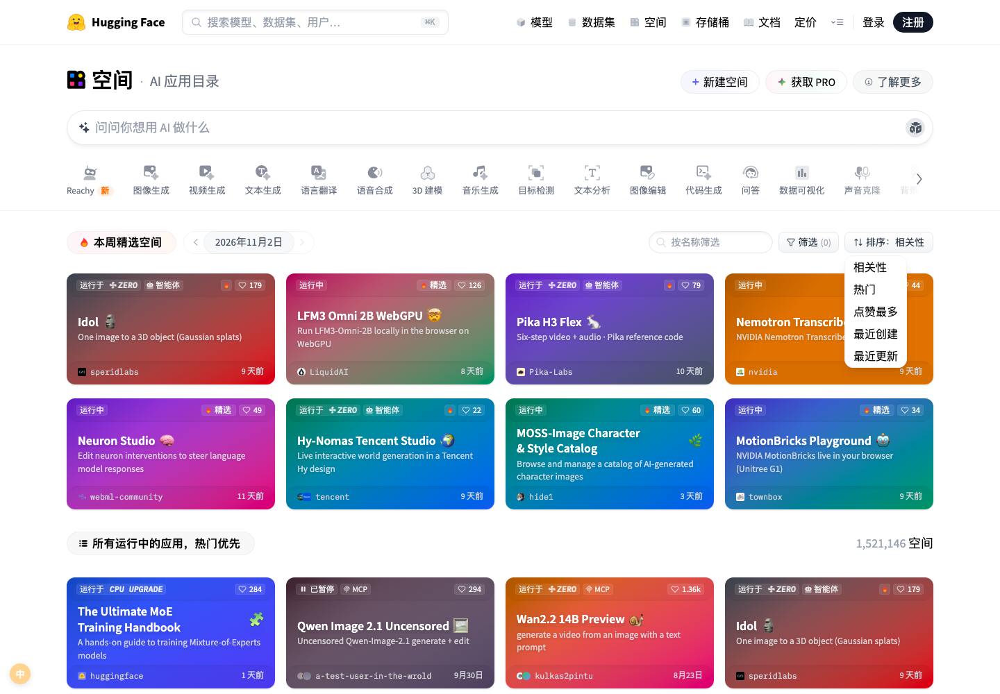
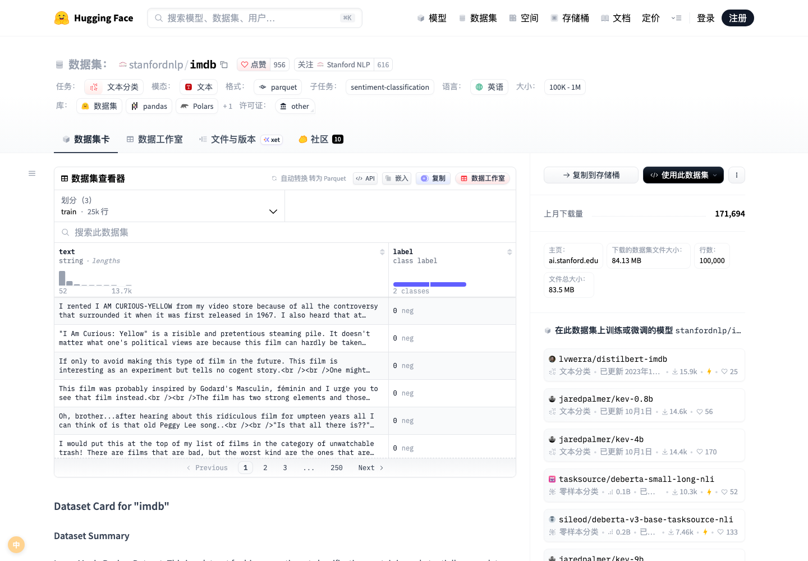

# Hugging Face 界面汉化

> 把 huggingface.co 整站变成中文界面。装一次，以后不用再猜「Apply filters」「Running on ZeroGPU」「Use this model」是什么意思。

---

## 这是什么

一个用户脚本（UserScript），运行在浏览器里，把 Hugging Face 网站的**界面文案**翻译成简体中文：导航栏、搜索框、筛选面板里几十个分组、排序下拉、模型/数据集/空间的详情页、定价页、文档侧栏、页脚，以及右上角那些下拉菜单。

它不改动页面结构、不注入样式、不发任何网络请求、不读取你的账号数据——所有翻译都写死在脚本里，用 `@grant none` 运行，离线也能工作。

作者：**陈鑫宇**。

---

## 为什么值得装

**1. 覆盖得比较全。** 词典 729 条，另有 12 类动态规则（相对时间、`1.2k` 这类计数、`Sort: Trending` 这类拼接文本、`Split (3)` 这类带计数的标签）。实测 17 个页面注入后共渲染出约 6,900 处中文，剩下的基本都是仓库名、机构名、论文标题这些**本来就不该翻**的内容。

**2. 不会翻出「Most 喜欢」这种鬼东西。** 这是绝大多数同类脚本的通病：拿英文原文当正则、用 `includes` 做子串替换，于是 "Most liked" 里的 "liked" 被替换掉、"Reinforcement Learning" 变成「Reinforcement 学习ing」、README 正文里的普通单词被整片污染。本脚本用**整段文本精确匹配**：只有文本节点归一化后与词条完全相等才替换，一个字符都不差。宁可漏翻，绝不乱翻。

**3. 不会破坏模型卡和代码。** HF 的 README、许可证全文、代码块、等宽字体的仓库名都在跳过名单里。你打开一个模型页，正文仍然是英文原文，界面框架是中文——这才是汉化该有的边界。

**4. 动态内容也跟得上。** HF 是单页应用，点链接不刷新页面。脚本挂了 `MutationObserver`（90ms 去抖）+ `pushState`/`replaceState`/`popstate` 钩子，切换路由、展开下拉、滚动加载第二批卡片，新出现的文案都会被翻译。

**5. 随时可关。** 左下角圆形的「中 / EN」按钮，或按 **Alt+Z**，一键切回原版英文，状态记在 localStorage 里，刷新后保持。

---

## 覆盖范围

| 位置 | 内容 |
| --- | --- |
| 顶部导航 | 模型 / 数据集 / 空间 / 存储桶 / 文档 / 定价 / 登录 / 注册，展开后的任务分类与参数档位 |
| 搜索 | 搜索框占位符、快捷键提示、搜索结果页的筛选与解析区块 |
| 列表页 | `/models` `/datasets` `/spaces` 左侧筛选面板全部分组（任务、库、语言、许可证、其他、模态、大小、格式、类型）、任务图标条、排序下拉的全部选项、`1,521,138 空间` 这类计数、`更新 2 天前` 这类时间 |
| 模型页 | 标签页（模型卡 / 文件与版本 / 社区）、点赞与关注、下载量、参数量、张量类型、许可证、gated 提示、**使用此模型** 下拉（库 / 推理 / 推理服务商 / 笔记本 / 本地应用 / Colab / Kaggle / vLLM / SGLang）、部署、复制到存储桶、模型树、推理服务商区 |
| 数据集页 | 数据集查看器、划分 / 子集 / 列统计、全文搜索、分页、元信息（行数、文件大小、主页）、`在此数据集上训练或微调的模型` |
| 空间页 | 分类导航（图像生成 / 视频生成 / 语音合成 / 3D 建模 / 目标检测 / 声音克隆……）、卡片角标（**运行于 ZeroGPU / 智能体 / 精选 / 运行中 / 已暂停**）、本周精选、筛选与排序 |
| 其它 | 定价页三档套餐与全部权益条目、文档侧栏、社区帖子列表、Learn、博客列表、组织页、登录注册页、页脚三栏、`document.title` |

---

## 安装

**方式一（推荐）**：先装 [Tampermonkey](https://www.tampermonkey.net/) 或 [Violentmonkey](https://violentmonkey.github.io/)，然后打开本脚本页面点「安装」。

**方式二（手动）**：打开 `hf-zh.user.js`，复制全文 → 油猴面板「添加新脚本」→ 粘贴覆盖 → Ctrl/Cmd+S 保存。

支持 Chrome / Edge / Firefox / Safari（配 ScriptCat 或 Userscripts）。首次安装后打开 huggingface.co 即生效，无需刷新缓存。

---

## 使用

- 默认开启，页面加载完 400ms 内完成首屏翻译。
- **Alt+Z** 或点击**左下角圆形按钮**在「中 / EN」之间切换；选择会记住。
- 想临时看原文的某一段，直接切到 EN 再切回来即可，脚本会还原所有被改写的文本节点。

---

## 设计取舍：为什么有些地方还是英文

这不是漏翻，是刻意的：

- **模型卡 / 数据集卡的正文**（README、许可证全文、说明段落）——那是内容不是界面，翻了反而看不懂术语。
- **仓库名、机构名、库名、论文标题、数据集列名**——专有名词，翻译会导致无法复制粘贴去搜索。
- **代码块、`<pre>`、等宽字体区**——里面的内容一旦被改就是事故。
- **图表 / Canvas 里的文字**——不是 DOM 文本，脚本碰不到。
- **登录后的深层设置页**（账单、令牌管理、仓库设置）——需要账号才能抓文案，本期覆盖较少，欢迎反馈补充。

---

## 和旧版汉化脚本的区别

网上流传的旧版（2022 年）有三个硬伤，本脚本是为绕开它们重写的：

1. **词典用 `new Map([...])` 且存在大量重复 key**（Profile / Models / Datasets / Spaces 等），后写的覆盖前者，翻译静默丢失。本脚本构建时**强制查重**，重复即构建失败。
2. **把英文原文当正则用**（`. ? ( +` 全是元字符），再配 `includes` 子串匹配，于是出现「Most 喜欢」「网页search 2.0」「空间 of the week」。本脚本只用整段相等匹配。
3. **一次性遍历 + 无去抖的 MutationObserver**，且不跳过 `code`/`pre`，把正文也搅了。本脚本有跳过名单、去抖、路由钩子与关闭还原。

---

## 常见问题

**Q：会不会被 HF 检测 / 影响账号？**
不会。脚本只在本地改 DOM 文本，没有任何网络请求，不碰 cookie 和 token。

**Q：为什么新出现的弹窗偶尔还是英文？**
HF 的界面更新很频繁。新文案会落在 90ms 后的下一轮扫描里；如果整体是英文，多半是词条缺失——欢迎在 GreasyFork 反馈页留言，附上页面链接与那句英文。

**Q：手机上能用吗？**
需要支持用户脚本的移动浏览器（如 Kiwi、Firefox + 油猴插件），未做专门适配。

**Q：翻错了怎么办？**
Alt+Z 立刻切回英文。翻译错误请在反馈区指出「英文原文 → 期望译法」，下一版修正。

---

## 实测数据

用 Playwright 注入真实脚本，走真实网络访问 17 个页面（首页、模型/数据集/空间列表、模型页、数据集页、论文、定价、任务、搜索、对话、Learn、博客、文档、组织、帖子、登录），统计注入后页面中的中文条目数：

- 首页 686 处、模型列表 527 处、数据集列表 435 处、空间列表 527 处、模型页 445 处、数据集页 317 处、定价页 832 处、文档 602 处、组织页 671 处……
- 剩余英文绝大多数是仓库名 / 机构名 / 论文标题 / 帖子正文 / Cloudflare 人机验证页。

---

## 更新日志

**1.0.0** — 首个版本。729 条词条 + 12 类动态规则；覆盖导航、筛选、排序、模型/数据集/空间/定价/文档/搜索页与全部下拉；整段精确匹配，跳过正文与代码；路由钩子与去抖；Alt+Z 与原位还原。

---

## 作者与许可

作者：**陈鑫宇** · 许可证：MIT · 仅供学习与个人使用，与 Hugging Face 官方无关。
